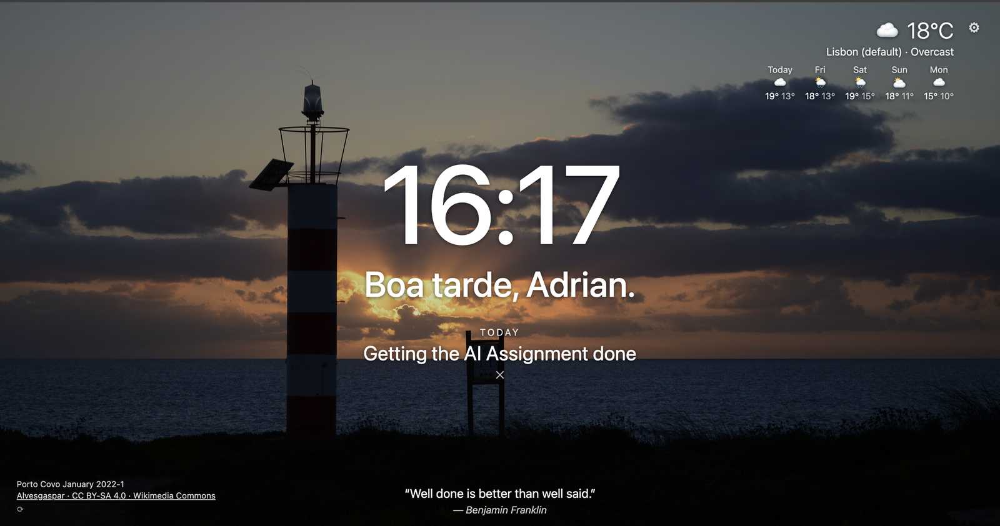

# 01 · Momentum Dash replica — "Bom Dia" start page



## Purpose

A Chrome extension that replaces the empty new-tab page with a personal start page, inspired by
[Momentum Dash](https://momentumdash.com). Every new tab shows:

- a **changing background photo of Portuguese nature** (Alentejo coast, Madeira, Azores, …) with photographer credit,
- the **local weather**: current temperature and a 5-day forecast,
- a **daily motivational quote** (with a few Portuguese proverbs mixed in),
- a clock, a Portuguese greeting ("Bom dia / Boa tarde / Boa noite") with your name, and a "main focus for today" field.

## Data collection

| Data | Source | How it is obtained |
|------|--------|--------------------|
| Background photos | [Wikimedia Commons](https://commons.wikimedia.org) | `data/backgrounds.json` lists 10 hand-picked Commons file names. The [Commons API](https://www.mediawiki.org/wiki/API:Imageinfo) (`action=query&prop=imageinfo`) returns a 2560 px image URL, the author and the licence for each file. |
| Weather | [Open-Meteo Forecast API](https://open-meteo.com/en/docs) | `GET /v1/forecast` with latitude/longitude → current temperature, weather code, 5-day min/max. Free, no API key. |
| Location | Browser geolocation, or a city chosen in Settings | `navigator.geolocation` (rounded to ~1 km). A chosen city is looked up with the [Open-Meteo Geocoding API](https://open-meteo.com/en/docs/geocoding-api). The town name for the current position comes from [BigDataCloud's free reverse-geocoding endpoint](https://www.bigdatacloud.com/free-api/free-reverse-geocode-to-city-api). If location is unavailable, Lisbon is used. |
| Quotes | `data/quotes.json` (bundled) | 26 quotes; the same quote is shown all day and the next one tomorrow (`day number % number of quotes`). Bundled on purpose: works offline and needs no third-party quote API. |

None of the APIs needs a key, so there are no secrets in this project.

## Data persistence

Everything is stored locally in the browser with `chrome.storage.local` (nothing leaves the computer except the API requests above):

| Key | What | Why |
|-----|------|-----|
| `settings` | name, location mode, chosen city, °C/°F, background change interval | remember preferences between tabs |
| `focus` | today's focus text + date | the focus is shown all day and disappears automatically the next day |
| `weatherCache` | last forecast + time fetched | max. one weather request per 30 minutes, however many tabs are opened |
| `photoCache` | photo URLs, authors, licences | the Commons API is asked at most once every 7 days |
| `bgState` | which photo is shown | so the rotation continues instead of restarting |
| `placeNames` | coordinates → town name | coordinates of a place never change, so they are looked up once |

When the page is opened as a normal web page (for testing, not as an extension), `js/storage.js` falls back to `localStorage`.

## User interaction

1. Open a new tab — the start page appears.
2. Type your main focus and press **Enter**; click **✕** to clear it.
3. Click **⟳** (bottom left) for the next photo; click the credit to open the photo on Commons.
4. Click **⚙** (top right) to set your name, weather location (current location or search a city), °C/°F and how often the background changes (every tab / hour / day). Click **Done** to save.

## Setup

Requirements: Google Chrome (or another Chromium browser such as Edge or Brave). No installation of packages, no build step.

1. Clone the repository: `git clone https://github.com/vj424r4jvs-spec/Applied-Programming-AI.git`
2. Open `chrome://extensions` and switch on **Developer mode** (top right).
3. Click **Load unpacked** and select the folder `01-momentum-dash`.
4. Open a new tab. If Chrome asks whether to keep the changed new-tab page, choose **Keep it**.

After changing the code, click the reload icon on the extension card in `chrome://extensions`.

### Project structure

```
01-momentum-dash/
├── manifest.json        extension definition (Manifest V3): new-tab override, permissions
├── newtab.html          page layout
├── css/style.css        styling
├── js/main.js           clock, greeting, focus, settings; starts the other modules
├── js/background.js     Commons API, photo rotation, fade-in, credit line
├── js/weather.js        geolocation, Open-Meteo forecast + city search, caching
├── js/quote.js          daily quote
├── js/storage.js        chrome.storage wrapper (localStorage fallback)
├── data/backgrounds.json  list of Commons photos
├── data/quotes.json     quotes
└── icons/               extension icons
```

## Learning

> ✏️ **To write in my own words** (this section is graded on what *I* learned). Points to cover:
> - What a browser extension is made of (`manifest.json`, permissions, `chrome_url_overrides`).
> - Calling a REST API with `fetch` and reading the JSON (Open-Meteo, Commons).
> - Why caching matters (every new tab would otherwise call the APIs).
> - A challenge and how I approached it — e.g. finding freely licensed nature photos and having to show author and licence; or the location fallback when geolocation is blocked.

## Limitations and assistance

- **Limitations:** only 10 photos (more can be added to `data/backgrounds.json`); quotes are a fixed list of 26; weather icons are emoji, so they look slightly different per operating system; no to-do list or search bar like the real Momentum; tested in Chrome only.
- **Photos:** from Wikimedia Commons; each photo's author and licence are shown on the page and linked to its Commons page.
- **AI assistance:** I used Claude (Anthropic) as a coding assistant to plan the features, write the code and draft this README. I tested the extension myself in Chrome, and I reviewed and adjusted the code.
- **External code:** none; no libraries or frameworks are used.
