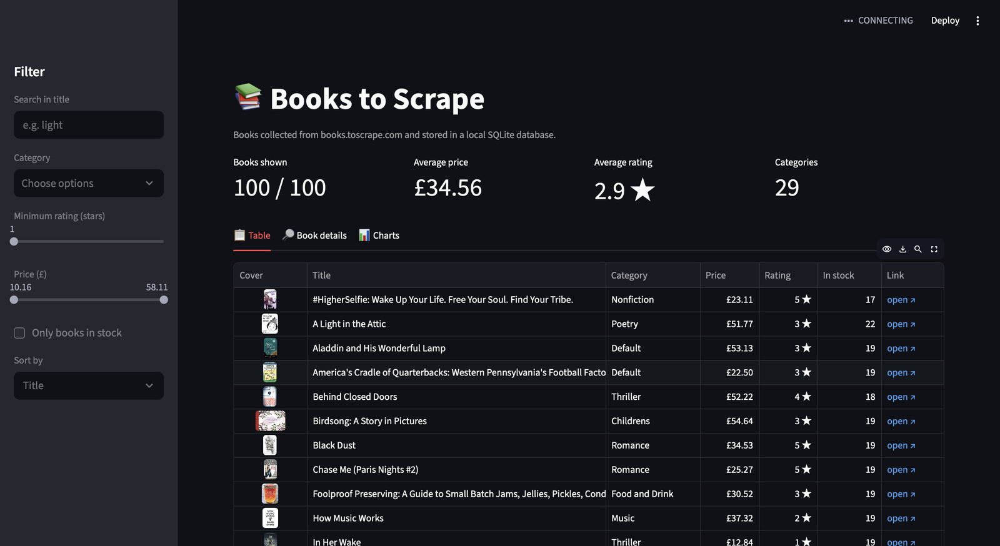

# 02 · Books to Scrape



## Purpose

A web scraper that collects book data from [books.toscrape.com](https://books.toscrape.com) (a practice
website built for learning web scraping), stores it in a SQLite database and shows it in a
small web app made with [Streamlit](https://streamlit.io). In the app you can search, filter, sort,
look at a single book and see charts.

## Data collection

- **Source:** books.toscrape.com: 1000 fictional books on 50 catalogue pages (20 books each).
- **How:** `scrape_books.py` uses `requests` to download the HTML and `BeautifulSoup` to read it.
  1. It opens catalogue page *n* (`/catalogue/page-n.html`) and collects the links to its 20 books.
  2. For each book it opens the book's own page and reads: title, category (from the breadcrumb),
     prices with and without tax, tax, number in stock, star rating (stored only as a CSS class,
     e.g. `star-rating Three` → 3), number of reviews, description, cover image URL and UPC (product code).
  3. Text such as `£51.77` or `In stock (22 available)` is converted to numbers with regular expressions.
- **Politeness:** a pause of 0.3 s between requests, a timeout, and an honest `User-Agent`.
- **Errors:** if one book fails it is skipped and counted; if a catalogue page can't be loaded the run stops with a message.

## Data persistence

- **What:** one table `books` with 13 columns (see `init_db()` in `scrape_books.py`).
- **Where:** `books.db`, a SQLite file created next to the script.
- **Why SQLite:** it is built into Python, needs no server, account or password, and anyone who clones the repo can run the project immediately. (An earlier version used a hosted Supabase/PostgreSQL database. I switched because it needed credentials in a `.env` file, and the free project pauses after a week without use, so other people could not reproduce it.)
- **No duplicates:** the UPC is the primary key. Re-running the scraper *updates* existing books (`INSERT … ON CONFLICT(upc) DO UPDATE`) instead of adding them again.
- `books.db` is **not committed to Git** (it is generated data, see `.gitignore`); you create it by running the scraper.

## User interaction

1. Run the scraper: it prints every book it saves, e.g. `[  12] Sapiens: A Brief History of Humankind  £ 54.23  ★★★★★`.
2. Start the app and open http://localhost:8501:
   - **Sidebar:** search in titles, choose categories, minimum star rating, price range, "only in stock", sort order.
   - **Key figures:** number of books shown, average price, average rating, number of categories.
   - **📋 Table:** covers, titles, prices, ratings, stock and a link to the book's page; **Download as CSV** exports the filtered list.
   - **🔎 Book details:** choose a book to see its cover, all details and the description.
   - **📊 Charts:** books per category, books per star rating, average price per category.

## Setup

Requirements: Python 3.9 or newer (the `python3` that comes with macOS works), internet connection.

```bash
cd 02-books-to-scrape

# 1. (recommended) create and activate a virtual environment
python3 -m venv .venv
source .venv/bin/activate          # Windows: .venv\Scripts\activate

# 2. install the libraries
python3 -m pip install -r requirements.txt

# 3. scrape books into books.db
python3 scrape_books.py            # 2 pages = 40 books (~30 seconds)
python3 scrape_books.py --pages 5  # 100 books
python3 scrape_books.py --all      # all 1000 books (~10 minutes)

# 4. start the interface (opens in the browser; stop with Ctrl+C)
streamlit run app.py
```

On macOS the commands are `python3`/`pip3`; on Windows usually `python`/`pip`.
No configuration file or API key is needed.

| File | Role |
|------|------|
| `scrape_books.py` | scraper: downloads, parses and saves the books |
| `app.py` | Streamlit interface: reads `books.db` and displays it |
| `requirements.txt` | Python libraries |
| `books.db` | the database (created by the scraper, not in Git) |

## Learning

> ✏️ **To write in my own words.** Points to cover:
> - How HTML is structured and how CSS selectors (`article.product_pod h3 a`, `#product_description + p`) find data in it.
> - Why the scraper opens each book's page (the catalogue page doesn't show category, UPC or description).
> - Primary keys and "upsert": why running the scraper twice does not create duplicates.
> - **Challenge:** the first version used Supabase and did not work on my Mac. The causes were `python`/`pip` vs `python3`/`pip3`, libraries installed into a different Python than the one VS Code used, and the `.env` file with the connection string. What I learned from it, and why I then chose SQLite for reproducibility.

## Limitations and assistance

- **Limitations:** by default only the first 2 catalogue pages are scraped (use `--all` for everything); the scraper is written for this site's HTML and would break if the layout changed; prices are in £ as shown on the site; there is no automatic re-scraping. Re-scraping updates books but never deletes books that disappeared from the site.
- **Data:** books.toscrape.com is a sandbox site explicitly meant for scraping practice; the books and prices are fictional.
- **AI assistance:** I used Claude (Anthropic) as a coding assistant to write and debug the scraper and the Streamlit app and to draft this README. I ran the code myself, checked the results in the database and the app, and reviewed the code.
- **External code / libraries:** `requests`, `beautifulsoup4`, `pandas`, `streamlit` (see `requirements.txt`). No code was copied from tutorials.
